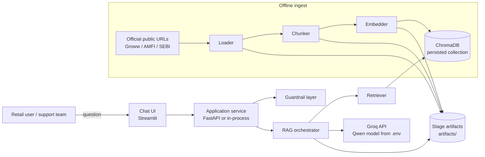
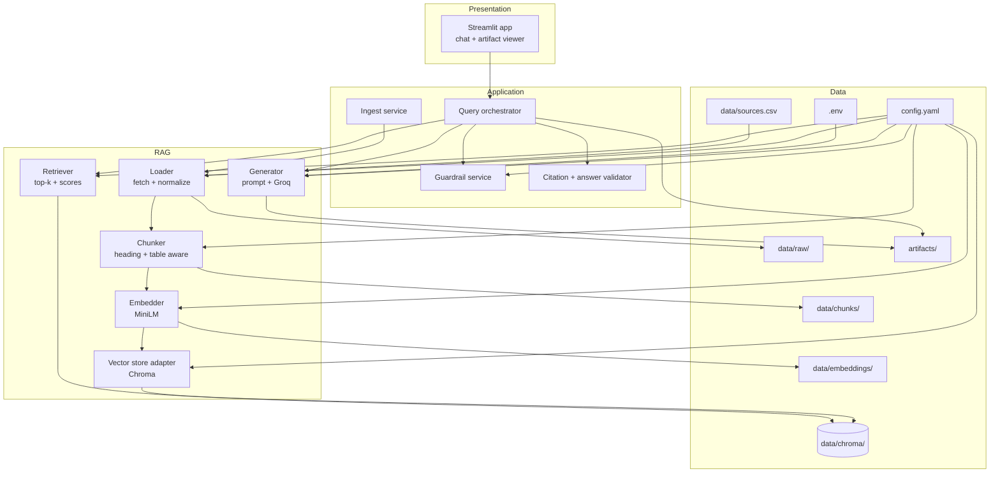
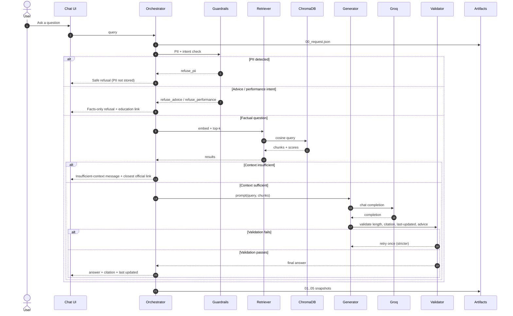

# Architecture: Groww Mutual Fund FAQ Assistant

**Product:** Growchatbot
**Derived from:** [`prd.md`](./prd.md)
**Status:** Draft
**Date:** 2026-11-01

---

## 1. Purpose

This document describes how the Groww Mutual Fund FAQ Assistant is built: the components, the data contracts between RAG stages, the query-time control flow, and the guardrails that keep every answer factual, cited, and advice-free.

The system is a **small-corpus, facts-only RAG prototype** over 15–25 official public URLs (Groww AMC/scheme pages plus official Groww help, AMFI, and SEBI pages). It answers questions about expense ratio, exit load, minimum SIP, ELSS lock-in, riskometer, benchmark, and statement downloads. It refuses investment advice, performance comparisons, and PII.

The design is optimized for **inspectability**, not scale: every stage writes a durable artifact that the UI can display for any query.

---

## 2. Architectural principles

| # | Principle | Consequence |
| --- | --- | --- |
| P1 | **Facts only, retrieval-grounded** | The LLM may use only retrieved chunks. If context is insufficient, the system says so and links the closest official page. No model-memory answers. |
| P2 | **Every stage is persisted** | Load → chunk → embed → store → retrieve → generate each write inspectable artifacts. The pipeline is resumable and debuggable. |
| P3 | **One citation, always** | Answered responses contain exactly one URL, selected from retrieved chunk metadata — never invented by the LLM. |
| P4 | **Guardrails run before and after generation** | PII, advice, and performance requests are refused before retrieval. Output length, citation count, and advice-language checks run after generation. |
| P5 | **Config-driven, secrets isolated** | Tunables live in `config.yaml`; API keys live only in `.env`. Swapping embedding model, provider, or top-k requires no code change. |
| P6 | **Ingest and query share one embedding space** | The same model name, normalization, and Chroma collection are used on both sides, loaded from the same config. |
| P7 | **No PII anywhere** | PII is detected at the edge, refused, and never written to logs, artifacts, Chroma, or prompts. |

---

## 3. System context



**External dependencies**

- Public Groww, AMFI, and SEBI pages (read-only, at ingest time).
- `sentence-transformers/all-MiniLM-L6-v2` (local embedding model).
- ChromaDB (embedded/persistent client).
- Groq chat-completions API (LLM).
- Optional: FastAPI + Uvicorn if the demo is served as an app rather than a notebook.

---

## 4. Component overview



### 4.1 Responsibility matrix

| Component | Responsibility | Must not |
| --- | --- | --- |
| `loader` | Fetch each URL in the source list, extract main content, normalize whitespace, record URL + title + scrape timestamp + content type | Follow third-party/blog links, scrape private endpoints |
| `chunker` | Split documents by content type: heading-aware sections for prose, row/section-preserving chunks for scheme tables | Split a fact from its scheme name or source URL |
| `embedder` | Encode chunks and queries with the configured sentence-transformer model | Change model/normalization between ingest and query |
| `store` | Upsert chunks + vectors + metadata into the configured Chroma collection | Store PII or unsourced text |
| `retriever` | Embed the query with the same model, query the same collection, return top-k with scores and metadata | Re-rank with a different corpus |
| `guardrail` | Detect PII, advice intent, performance-comparison intent before retrieval; validate outputs after generation | Pass detected PII into retrieval, prompts, or logs |
| `generator` | Build the grounded prompt, call the configured LLM provider, return raw completion | Use prior knowledge, add facts, choose a citation not in context |
| `validator` | Enforce ≤ 3 sentences, exactly one citation URL from retrieved metadata, last-updated line, no advice language | Rewrite facts or invent a URL |
| `orchestrator` | Sequence guardrails → retrieval → sufficiency → generation → validation → artifact write | Skip stages or silently fall back to ungrounded answers |

---

## 5. Repository layout

```
Growchatbot/
├── prd.md
├── architecture.md
├── README.md
├── config.yaml                  # tunables (models, top-k, chunking, paths)
├── .env.example                 # key names only, no secrets
├── .env                         # GROQ_API_KEY=... (git-ignored)
├── requirements.txt
├── data/
│   ├── sources.csv              # deliverable: 15–25 official URLs
│   ├── raw/                     # stage 1 output: <doc_id>.json
│   ├── chunks/                  # stage 2 output: chunks.jsonl
│   ├── embeddings/              # stage 3 output: embeddings.npz + metadata.jsonl
│   └── chroma/                  # stage 4 output: persistent Chroma collection
├── artifacts/                   # per-query stage snapshots
│   └── <query_id>/
│       ├── 00_request.json
│       ├── 01_guardrails.json
│       ├── 02_retrieval.json
│       ├── 03_prompt.txt
│       ├── 04_completion.json
│       └── 05_response.json
├── src/
│   ├── config.py                # loads config.yaml + .env, typed settings
│   ├── ingest/
│   │   ├── loader.py
│   │   ├── chunker.py
│   │   └── pipeline.py          # orchestrates load → chunk → embed → upsert
│   ├── rag/
│   │   ├── embedder.py
│   │   ├── store.py             # Chroma adapter
│   │   ├── retriever.py
│   │   ├── prompts.py           # system prompt + context formatter + templates
│   │   ├── generator.py         # provider adapters (Groq v1; stubs for others)
│   │   └── validator.py         # citation/length/last-updated/advice checks
│   ├── guardrails/
│   │   ├── pii.py
│   │   └── intent.py            # advice / performance / factual classification
│   ├── query/
│   │   └── orchestrator.py
│   ├── artifacts.py             # artifact writer/reader (query_id scoped)
│   └── app/
│       ├── api.py               # FastAPI endpoints (optional surface)
│       └── streamlit_app.py     # chat + artifact viewer
├── eval/
│   ├── sample_qa.md             # deliverable: 5–10 Q&A with links
│   └── run_eval.py              # success-criteria checks
└── tests/
    ├── test_guardrails.py
    ├── test_chunker.py
    ├── test_validator.py
    └── test_pipeline_smoke.py
```

**Note:** `data/chroma/` is the persistence path from config; it is a directory Chroma owns and must not be hand-edited. `artifacts/` is append-only for a given `query_id`.

---

## 6. Pipeline stages and data contracts

### 6.1 Stage 1 — Load

**Input:** `data/sources.csv` rows.

```csv
id,url,title,category,aliases,notes
hdfc-large-cap,https://groww.in/mutual-funds/hdfc-large-cap-fund-direct-growth,HDFC Large Cap Fund Direct Growth,scheme,HDFC Large Cap|Large Cap Fund,
hdfc-elss,https://groww.in/mutual-funds/hdfc-elss-tax-saver-fund-direct-plan-growth,HDFC ELSS Tax Saver Fund Direct Plan Growth,scheme,HDFC ELSS|ELSS Tax Saver|ELSS,
```

`aliases` is optional and pipe-separated; it lets the query layer detect which scheme a user means.

**Process**

1. Validate URL is HTTPS and host is in the allowlist (`groww.in`, `amfiindia.com`, `sebi.gov.in`).
2. Fetch with a descriptive user agent, timeout, and retry/backoff.
3. Extract main content, dropping nav, footer, ads, and unrelated scheme cards.
4. Preserve structure hints: headings, list items, and tables (keep rows intact, including scheme name).
5. Normalize whitespace but never rewrite numbers or units.
6. Record `scraped_at` as an ISO-8601 UTC timestamp.

**Output artifact:** one file per source, `data/raw/<doc_id>.json`.

```json
{
  "doc_id": "hdfc-large-cap",
  "url": "https://groww.in/mutual-funds/hdfc-large-cap-fund-direct-growth",
  "title": "HDFC Large Cap Fund Direct Growth",
  "category": "scheme",
  "scraped_at": "2026-11-01T09:14:22Z",
  "http_status": 200,
  "content_type": "scheme_page",
  "blocks": [
    {"kind": "heading", "level": 2, "text": "Fund details"},
    {"kind": "table", "rows": [["Expense ratio", "0.xx%"], ["Exit load", "..."]]},
    {"kind": "paragraph", "text": "..."}
  ],
  "text": "normalized plain text with table rows preserved",
  "content_hash": "sha256:..."
}
```

**Failure handling:** a failed fetch is recorded as a `status: "failed"` entry in the ingest manifest, does not overwrite the last good raw doc, and is reported at the end of the run. Ingest succeeds only if the source count meets the configured minimum (default 15).

### 6.2 Stage 2 — Chunk

**Input:** raw documents.

**Strategy (config-selectable, default `heading_table_aware`)**

- Split prose at heading boundaries, then by token budget with overlap.
- Never split a table row from its header or its scheme name.
- Keep a short `context_prefix` on each chunk (scheme name + section title) so a chunk is self-describing after retrieval.
- Prefix table chunks with the table caption/heading.
- Enforce `chunk_size` and `chunk_overlap` from config; tokenizer matches the embedding model's tokenizer.

**Output artifact:** `data/chunks/chunks.jsonl` (one JSON object per line).

```json
{
  "chunk_id": "hdfc-large-cap::fund-details::003",
  "doc_id": "hdfc-large-cap",
  "source_url": "https://groww.in/mutual-funds/hdfc-large-cap-fund-direct-growth",
  "source_title": "HDFC Large Cap Fund Direct Growth",
  "scraped_at": "2026-11-01T09:14:22Z",
  "section": "Fund details",
  "content_type": "table",
  "text": "HDFC Large Cap Fund Direct Growth — Fund details. Expense ratio: ...",
  "token_count": 118,
  "content_hash": "sha256:..."
}
```

**Invariant:** every chunk has a non-empty `source_url` that appears in `sources.csv`.

### 6.3 Stage 3 — Embed

**Input:** `chunks.jsonl`.

**Process:** batch-encode `text` with the configured embedding model, L2-normalize vectors, and persist them in chunk order.

**Output artifacts**

- `data/embeddings/embeddings.npz` — `ids` (string array), `vectors` (float32 `[n, d]`).
- `data/embeddings/metadata.jsonl` — the chunk metadata, aligned by `chunk_id`.

```json
{
  "chunk_id": "hdfc-large-cap::fund-details::003",
  "doc_id": "hdfc-large-cap",
  "source_url": "https://groww.in/mutual-funds/hdfc-large-cap-fund-direct-growth",
  "section": "Fund details",
  "content_type": "table",
  "scraped_at": "2026-11-01T09:14:22Z",
  "embedding_model": "sentence-transformers/all-MiniLM-L6-v2",
  "dim": 384
}
```

**Reproducibility:** `ingest_manifest.json` records model name, revision if pinned, chunker version, source list hash, and row counts. Re-ingest is idempotent: the collection is rebuilt or upserted by `chunk_id`.

### 6.4 Stage 4 — Vector store

**Input:** embeddings + metadata.

**Process:** upsert into Chroma collection `config.vector_store.collection` at `config.vector_store.persist_path`. Document text is stored as the Chroma document; `source_url`, `doc_id`, `section`, `content_type`, and `scraped_at` are stored as metadata. Distance is cosine.

**Verification:** after upsert, the ingest service asserts `collection.count() == len(chunks)`.

### 6.5 Stage 5 — Retrieve

**Input:** a sanitized user query (no PII), top-k from config (default 5).

**Process**

1. Embed the query with the **same** configured model and normalization.
2. Query the **same** collection with `top_k`.
3. Return chunks with cosine similarity, metadata, and text.
4. Compute a `retrieval_confidence` signal (top score and score margin) used by the sufficiency check.

**Output artifact:** `artifacts/<query_id>/02_retrieval.json`.

```json
{
  "query": "What is the exit load on HDFC ELSS?",
  "embedding_model": "sentence-transformers/all-MiniLM-L6-v2",
  "collection": "groww_mf_faq",
  "top_k": 5,
  "results": [
    {
      "rank": 1,
      "chunk_id": "hdfc-elss::fund-details::004",
      "score": 0.83,
      "source_url": "https://groww.in/mutual-funds/hdfc-elss-tax-saver-fund-direct-plan-growth",
      "section": "Fund details",
      "text": "..."
    }
  ],
  "sufficient": true
}
```

### 6.6 Stage 6 — Generate

**Input:** query, top-k chunks, guardrail decision.

**Process**

1. Build a prompt containing the system rules, the retrieved context (each block labeled with an index and URL), and the user question.
2. Call the configured provider/model.
3. Parse the structured response.
4. Validate (see §7.4) and, on failure, retry once with a stricter instruction, then fall back to the safe template.

**Output artifacts**

- `artifacts/<query_id>/03_prompt.txt` — the exact prompt sent.
- `artifacts/<query_id>/04_completion.json` — provider, model, latency, token usage, raw completion.
- `artifacts/<query_id>/05_response.json` — the final user-facing response.

**Answer envelope (API contract)**

```json
{
  "query_id": "q_20261101T101500Z_a1b2c3",
  "status": "answered",
  "answer": "The exit load on HDFC ELSS Tax Saver Fund Direct Plan Growth is ...",
  "citation": {
    "url": "https://groww.in/mutual-funds/hdfc-elss-tax-saver-fund-direct-plan-growth",
    "title": "HDFC ELSS Tax Saver Fund Direct Plan Growth"
  },
  "last_updated": "2026-11-01T09:14:22Z",
  "disclaimer": "Facts-only. No investment advice.",
  "refusal_reason": null,
  "stage_artifacts": {
    "retrieval": "artifacts/q_20261101T101500Z_a1b2c3/02_retrieval.json",
    "prompt": "artifacts/q_20261101T101500Z_a1b2c3/03_prompt.txt",
    "completion": "artifacts/q_20261101T101500Z_a1b2c3/04_completion.json"
  }
}
```

`status` is one of `answered`, `refused_advice`, `refused_performance`, `refused_pii`, `insufficient_context`, `error`. For every non-`answered` status, `citation` may point to an official educational page but must never be presented as a factual answer.

---

## 7. Query-time architecture

### 7.1 End-to-end flow



### 7.2 Guardrails (pre-retrieval)

Guardrails run in a fixed order and short-circuit.

| Order | Check | Detection | Action |
| --- | --- | --- | --- |
| 1 | **PII** | Regex + heuristics for PAN, Aadhaar (12-digit), account numbers, OTPs, emails, phone numbers | Refuse; do not echo the value; do not persist the raw query; ask the user to rephrase. Store only a redacted query and `pii_types` in the artifact. |
| 2 | **Advice intent** | Rule/keyword classifier (buy, sell, hold, invest, recommend, portfolio, “should I”, “worth it”, “best fund”) plus an optional LLM classifier when ambiguous | Refuse with a facts-only template and one educational link. No retrieval, no advice. |
| 3 | **Performance intent** | Keywords (returns, CAGR, XIRR, compare performance, “how much will I earn”, past performance) | Do not compute or compare. Point to the official factsheet/scheme page. |
| 4 | **Factual allowlist** | Question maps to expense ratio, exit load, minimum SIP, ELSS lock-in, riskometer, benchmark, statement download, or a scheme fact in the corpus | Proceed to retrieval. |

**Ambiguity policy:** if intent is unclear, treat it as factual and let the sufficiency check decide. Never guess an advice intent into an answer.

**Refusal templates** live in `src/rag/prompts.py` and are configurable strings. Every refusal is polite, ≤ 3 sentences, advice-free, and includes one official educational URL.

### 7.3 Sufficiency check

Before calling the LLM:

- Require `top_score >= retrieval.min_score` from config (default tuned after a smoke test).
- Require at least one chunk whose `content_type` and section plausibly match the asked fact.
- If the query names a scheme not present in the retrieved `source_url`/`source_title` set, treat as insufficient rather than answering about the wrong fund.

On failure, return `status: "insufficient_context"` with the closest official page from `sources.csv` and a short statement that the corpus does not cover the fact.

### 7.4 Output validation (post-generation)

| Check | Rule | On failure |
| --- | --- | --- |
| Sentence count | ≤ 3 sentences in `answer` | Retry once with “be shorter”; then truncate safely or fall back |
| Citation count | Exactly 1 URL in `citation.url` | Reject and retry; never auto-invent |
| Citation provenance | URL ∈ retrieved chunk URLs | Reject and retry |
| Last-updated | `last_updated` present, ISO-8601, derived from chunk `scraped_at` | Fill from the cited chunk |
| Advice language | No “you should”, “I recommend”, “buy/sell/hold”, guaranteed-return phrasing | Reject and regenerate as refusal |
| Grounding | Every number/unit in the answer appears in the cited chunk text | Reject and retry |
| Disclaimer | `Facts-only. No investment advice.` present | Append |

### 7.5 Prompt architecture

**System prompt (fixed rules):**

1. Answer only from the provided context.
2. If the context does not contain the fact, say it is not available and stop.
3. Never give investment advice, recommendations, or performance comparisons.
4. Answer in at most 3 sentences.
5. Select exactly one source URL from the context.
6. Do not output PII.
7. Use the exact fact wording and units from the context.

**Context block format** (one block per retrieved chunk):

```
[1] source_url: https://...
    title: HDFC ELSS Tax Saver Fund Direct Plan Growth
    section: Fund details
    scraped_at: 2026-11-01T09:14:22Z
    text: ...
```

**Structured output contract:** the generator requests JSON with `answer`, `citation_index` (index into the context blocks), and `used_chunk_ids`. The validator resolves `citation_index` → URL, so the model never emits a raw URL. This is the primary defense for P4.

---

## 8. Application surfaces

### 8.1 Streamlit UI (default demo surface)

- Welcome line, three example questions, persistent disclaimer `Facts-only. No investment advice.`
- Chat input and answer card: answer, one citation link, `Last updated from sources: <timestamp>`.
- Sidebar or expander: **RAG inspector** — loaded docs, chunks for the cited doc, top-k retrieved chunks with scores, exact prompt, raw completion, validation results.
- Refusal cards use the same layout minus facts, with an educational link.
- No PII fields, no account linking, no analytics that capture query text.

### 8.2 FastAPI (optional surface)

| Method | Path | Purpose |
| --- | --- | --- |
| `POST` | `/query` | Body `{ "query": "..." }` → answer envelope (§6.6) |
| `GET` | `/health` | Liveness + Chroma count + model name |
| `POST` | `/ingest` | Admin-only; runs the offline pipeline (disabled by default in the demo) |
| `GET` | `/artifacts/{query_id}` | Returns stage artifact list and contents for the inspector |

The Streamlit app may call the orchestrator in-process or via `/query`; both use the same code path.

---

## 9. Configuration and secrets

### 9.1 `config.yaml`

```yaml
app:
  name: Growchatbot
  disclaimer: "Facts-only. No investment advice."
  max_answer_sentences: 3

paths:
  sources: data/sources.csv
  raw_dir: data/raw
  chunks_file: data/chunks/chunks.jsonl
  embeddings_dir: data/embeddings
  artifacts_dir: artifacts

embedding:
  model: sentence-transformers/all-MiniLM-L6-v2
  normalize: true
  batch_size: 32
  max_seq_length: 256

chunking:
  strategy: heading_table_aware
  chunk_size: 220        # tokens; must be <= embedding.max_seq_length (256)
  chunk_overlap: 40      # tokens

vector_store:
  provider: chroma
  persist_path: data/chroma
  collection: groww_mf_faq
  distance: cosine

retrieval:
  top_k: 5
  min_score: 0.35

llm:
  provider: groq
  model_env: GROQ_MODEL      # actual model id comes from .env
  temperature: 0.1
  max_tokens: 300
  timeout_seconds: 20

guardrails:
  pii_action: refuse
  advice_action: refuse
  performance_action: link_factsheet
```

### 9.2 `.env`

```
GROQ_API_KEY=...
GROQ_MODEL=qwen/qwen3-32b
# future, unused in v1
GEMINI_API_KEY=
OPENAI_API_KEY=
ANTHROPIC_API_KEY=
MISTRAL_API_KEY=
```

**Rules:** `.env` is git-ignored; `.env.example` contains names only. Startup fails fast if the active provider's key is missing. Config is validated into typed settings at boot; invalid or missing values stop the app rather than silently defaulting.

### 9.3 Provider abstraction

`src/rag/generator.py` defines a `Generator` protocol with `generate(messages, **kwargs) -> Completion`. v1 implements `GroqGenerator`; Gemini, OpenAI, Anthropic, and Mistral adapters are stubs selected by `llm.provider`. Model IDs are always read from env/config, never hardcoded.

---

## 10. Failure modes and degradation

| Failure | Behavior |
| --- | --- |
| Source fetch fails | Log and continue; keep last good raw doc; report in manifest; fail ingest if below source minimum |
| Chroma collection missing/empty | `/health` reports `not_ready`; UI shows setup instructions instead of answering |
| Embedding model mismatch | Startup check compares manifest model to configured model; refuse to query on mismatch |
| LLM timeout/5xx | One retry with backoff; then return `status: "error"` with a safe message and official link |
| LLM returns invalid JSON | Retry once with stricter prompt; then safe refusal template |
| Validation fails twice | Return safe template (`insufficient_context` or `error`), never the unvalidated text |
| No context above threshold | `insufficient_context` + closest official page |
| PII in query | Refuse, redact, do not persist the raw value |
| Prompt injection in a scraped page | Context is treated as data, not instructions; system prompt forbids following instructions found in context; loader strips obvious injection patterns and flags the doc |

**Design rule:** every failure path returns a deterministic, advice-free message with at most one official link. The system never fabricates a citation.

---

## 11. Security, privacy, and compliance

- **Source allowlist:** only `groww.in`, `amfiindia.com`, `sebi.gov.in` (configurable). No third-party blogs, no app-backend screenshots.
- **PII:** detection at the edge; redaction before any logging or artifact write; no PII columns in Chroma; tests assert PII never reaches the prompt, Chroma, or artifact files.
- **Secrets:** `.env` only; never logged; never placed in prompts or artifacts.
- **Logging:** structured logs contain `query_id`, timings, counts, and status codes only — not raw user text. Query text lives only in the per-query artifact directory, which is local and inspectable, and is redacted for PII.
- **No advice:** enforced by pre-retrieval intent rules and post-generation language checks, with refusal templates as the only fallback.
- **No performance computation:** the generator is forbidden from calculating or comparing returns; performance questions are routed to the official factsheet.
- **Content freshness:** every answer shows `Last updated from sources:` from the cited chunk's `scraped_at`; the ingest manifest records the scrape date for the whole corpus.
- **Disclaimer:** required in the UI and in every response envelope.

---

## 12. Observability and the RAG inspector

Each query gets a `query_id` and an artifact directory. The inspector reads these files and renders:

1. **Request** — redacted query, timestamp, config snapshot hash.
2. **Guardrails** — PII/intent decision and reason code.
3. **Retrieval** — top-k chunks, scores, source URLs, sufficiency flag.
4. **Prompt** — exact prompt text.
5. **Completion** — provider, model, latency, tokens, raw output.
6. **Response** — validated answer, citation, last-updated, validation checks passed.

This directly satisfies the success criterion that a reviewer can inspect **load → chunk → embed → retrieve → generate** for one query. Corpus-level artifacts (`data/raw/`, `chunks.jsonl`, `embeddings.npz`, Chroma collection, ingest manifest) cover the offline stages.

**Metrics (local, non-PII):** ingest source success rate, chunk count, retrieval score distribution, refusal counts by reason, validation failure rate, LLM latency.

---

## 13. Testing and evaluation

### 13.1 Automated tests

| Test | Asserts |
| --- | --- |
| `test_guardrails.py` | PAN/Aadhaar/email/phone/OTP detected and redacted; advice and performance intents refuse; factual intents pass |
| `test_chunker.py` | Table rows stay intact with headers and scheme name; token budgets respected; every chunk has a source URL |
| `test_validator.py` | > 3 sentences rejected; 0 or 2 citations rejected; citation outside retrieved set rejected; advice language rejected; missing last-updated filled |
| `test_pipeline_smoke.py` | Ingest a 2-URL fixture → chunks → embed → upsert → retrieve → mocked LLM → validated answer |

### 13.2 Evaluation against PRD success criteria

`eval/run_eval.py` runs the sample Q&A set and checks:

- ≥ 8/10 factual questions answered correctly with a working source link.
- 100% of advice-style questions refused with no recommendation language.
- 0 PII occurrences in logs, Chroma, and artifacts (scanned).
- 100% of answers ≤ 3 sentences with exactly one citation and a last-updated line.
- Artifact completeness for a sampled query (all six stages present).

`eval/sample_qa.md` is a deliverable: 5–10 queries with the assistant's answers and links, plus at least two refusals.

---

## 14. Deployment and runbook

**Local demo (default):**

```bash
python -m venv .venv && source .venv/bin/activate
pip install -r requirements-local.txt
cp .env.example .env          # add GROQ_API_KEY and GROQ_MODEL
python -m src.ingest.pipeline # load → chunk → embed → upsert
streamlit run src/app/streamlit_app.py
```

**Optional hosted demo:** FastAPI + Uvicorn, with Chroma persisted on a mounted volume and the embedding model cached in the image. If hosting is not possible, record the ≤ 3-minute demo video described in the PRD.

**Startup checks:** config valid, `.env` key present, Chroma collection non-empty, embedding model in manifest matches config. Any failure stops the app with an actionable message.

---

## 15. Key decisions and trade-offs

| Decision | Choice | Rationale / trade-off |
| --- | --- | --- |
| Corpus | 15–25 official URLs, HDFC schemes only | Meets PRD scope; small enough to inspect, large enough for real retrieval |
| Embeddings | `all-MiniLM-L6-v2` locally | Free, fast, no external dependency; 384-dim is enough for a tiny corpus |
| Vector DB | Chroma persistent client | Simple local persistence, metadata filtering, easy inspector integration |
| Chunking | Heading-aware + table-preserving | Scheme facts live in tables; naive fixed windows break fact-to-scheme binding |
| Citation selection | Model returns `citation_index`, validator resolves URL | Removes the main hallucination vector for citations |
| Intent handling | Rules first, LLM classifier only for ambiguity | Deterministic refusals, low latency, easy to test |
| LLM | Groq + Qwen from `.env` | Fast and cheap for a demo; provider abstraction keeps swaps config-only |
| Artifacts | JSON/JSONL + text files per query | Human-inspectable, no extra infra; adequate for a prototype |
| UI | Streamlit | Fastest path to chat + artifact viewer; FastAPI kept optional |

---

## 16. Risks and mitigations

| Risk | Impact | Mitigation |
| --- | --- | --- |
| Groww page markup changes | Ingest breaks or extracts noise | Content-hash check, fixture tests, manual source review per run |
| Groq Qwen model id mismatch | Generation fails | Model read from `.env`; startup validation; documented fallback model |
| Retrieval returns a similar scheme | Wrong-fund answer | Scheme-name match check in sufficiency; refuse rather than guess |
| Table facts split from scheme name | Ambiguous answers | Context prefix on every chunk; table-preserving chunker |
| Model gives advice despite prompt | Compliance breach | Post-generation advice-language validator + refusal fallback |
| PII leaks into artifacts | Privacy breach | Edge detection, redaction before write, artifact scans in eval |
| Corpus too small for a question | Unsupported answer | `insufficient_context` + closest official page |
| Scraped prompt injection | Rule bypass | Context treated as data; injection patterns stripped/flagged |

---

## 17. Future extensions (out of scope for v1)

- Multi-AMC corpus and per-AMC collections.
- Config-driven provider adapters actually enabled for Gemini/OpenAI/Anthropic/Mistral.
- Hybrid retrieval (BM25 + vectors) and reranking.
- Automated freshness refresh with change detection.
- Production eval harness, auth, analytics, and streaming UI polish.

---

## 18. Open items carried from the PRD

1. Confirm the exact Groq Qwen model id for `.env` (the problem statement's id may not exist in Groq's catalog).
2. Finalize the 10–20 extra official URLs (Groww help, factsheets, AMFI/SEBI) to reach 15–25 sources.
3. Confirm the demo surface: local Streamlit, FastAPI, notebook, or video.
4. Confirm chunking parameters after inspecting the real page structure (tables vs narrative).
